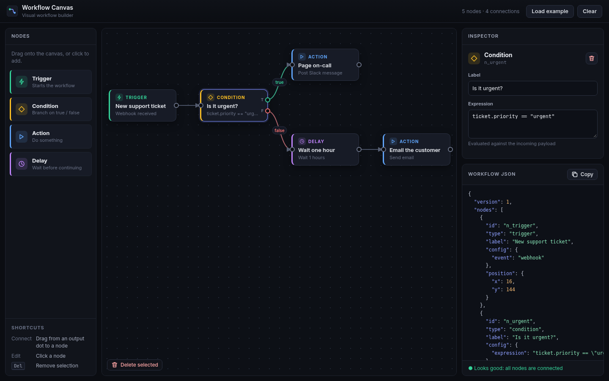
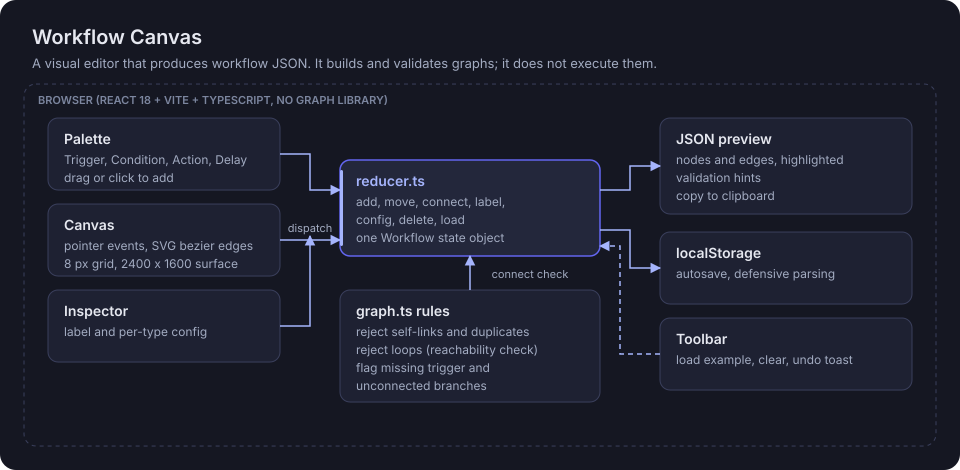

# Workflow Canvas

**Drag, connect and configure automation steps on a canvas, and get a clean, validated workflow JSON as you build.**

[](https://react.dev/)
[](https://www.typescriptlang.org/)
[](https://vite.dev/)
[](src/components/Canvas.tsx)
[](package.json)

**Live demo:** https://workflow-canvas-three.vercel.app

> **Example:** drop a Trigger set to "Record created", wire it to a Condition `ticket.priority == "urgent"`, send the `true` branch to a Slack action and the `false` branch to a 1 hour Delay. Try to wire the Delay back into the Condition and the canvas refuses with "That connection would create a loop." The JSON panel shows the finished graph, ready to copy.



## Architecture



A static single-page app. Dragging, connecting and edge drawing are written by hand with pointer events and SVG; there is no graph or diagram library.

## How it works

1. **Node types.** `nodeDefs.ts` defines Trigger, Condition, Action and Delay: their ports, config fields, defaults and geometry. Conditions have `true` and `false` outputs, Triggers have no input.
2. **One reducer.** Palette, Canvas and Inspector dispatch actions (`add`, `move`, `connect`, `label`, `config`, `deleteSelection`, `load`) to `reducer.ts`, which owns the single `Workflow` state. Moves snap to an 8 px grid on a 2400 x 1600 surface.
3. **Connection rules.** `graph.ts` rejects self-links, duplicates and any edge that would make a cycle, using a reachability check from the target back to the source. Each output port holds one edge; reconnecting replaces it.
4. **Validation hints.** `validateWorkflow` flags a missing trigger, nodes with no incoming edge and unconnected condition branches.
5. **Live JSON.** `buildWorkflowJson` serializes nodes (`id`, `type`, `label`, `config`, `position`) and edges (`from`, `to`, `port`) for the highlighted preview and copy button.
6. **Persistence.** `storage.ts` autosaves to `localStorage` and parses defensively on load. Load example and Clear both offer an Undo toast.

## Workflow JSON

```json
{
  "version": 1,
  "nodes": [
    { "id": "n_urgent", "type": "condition", "label": "Is it urgent?",
      "config": { "expression": "ticket.priority == \"urgent\"" }, "position": { "x": 232, "y": 144 } }
  ],
  "edges": [ { "id": "e_2", "from": "n_urgent", "to": "n_page", "port": "true" } ]
}
```

## Run locally

Requires Node.js 20.19 or newer.

```bash
npm install
npm run dev         # http://localhost:5173
npm run build       # strict type-check, then build to dist/
```

No environment variables are needed, so there is no `.env.example`.

## Evaluation

There is no automated test suite yet. `graph.ts` and `reducer.ts` are pure functions, so connection rules and validation are the natural first unit tests.

## Honest limitations

- A personal portfolio prototype with no real users.
- It is an editor, not an engine. Workflows are never executed, scheduled or sent anywhere; the email, Slack and HTTP actions are configuration only.
- Condition expressions are stored as plain text and are not parsed or checked.
- No zoom, pan gestures, multi-select or auto-layout.
- One workflow per browser, stored in `localStorage`. No import from JSON yet.
- No automated tests.

## Stack

React 18, TypeScript 5 (strict), Vite 7, hand-written SVG and pointer events, plain CSS with variables, browser `localStorage`.

Part of the Lab at https://www.abhidattasrichandan.com
